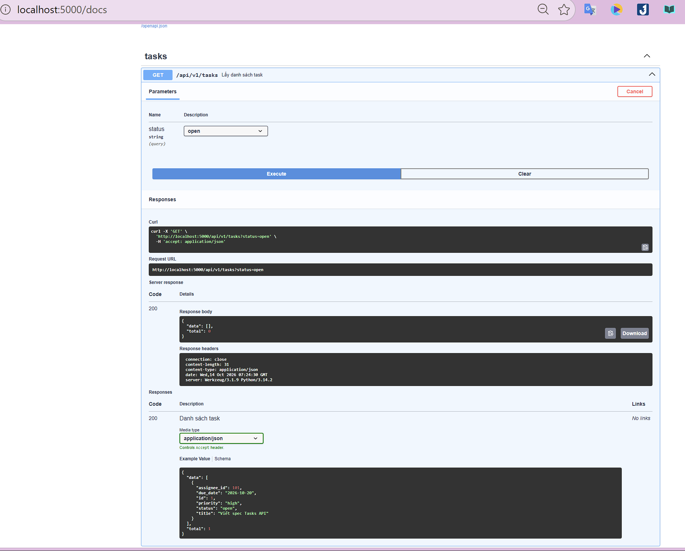

# Buổi 4 · Phần 4 — Flask + apispec

Tasks API với 5 endpoint. apispec sinh OpenAPI 3.0.3 từ marshmallow Schema và YAML docstring.

- `app.py`: Flask app + apispec
- `openapi.yaml`: spec xuất từ app (giống nội dung `GET /openapi.yaml`)

## Endpoint

| Method | URL | Mô tả |
|---|---|---|
| GET | `/api/v1/tasks?status=` | Lấy danh sách task |
| POST | `/api/v1/tasks` | Tạo task mới |
| GET | `/api/v1/tasks/<task_id>` | Lấy task theo id |
| PATCH | `/api/v1/tasks/<task_id>` | Cập nhật một phần task |
| DELETE | `/api/v1/tasks/<task_id>` | Xoá task |
| GET | `/openapi.json` | Spec dạng JSON |
| GET | `/openapi.yaml` | Spec dạng YAML |
| GET | `/docs` | Swagger UI |

## Các bước sinh spec

1. **Schema → JSON Schema**: `MarshmallowPlugin` chuyển `TaskSchema`, `UpdateTaskSchema`, `TaskListSchema`, `ErrorSchema` thành `components.schemas`.
2. **Docstring → paths**: `FlaskPlugin` đọc phần YAML sau dấu `---` trong docstring của từng route, rồi đăng ký bằng `spec.path(view=...)`.
3. **`/openapi.json`** trả về `spec.to_dict()`.
4. **`/docs`** hiển thị Swagger UI từ CDN, đọc spec từ `/openapi.json`.

## Kết quả thực hành

<table>
  <tr>
    <td align="center">
      
    </td>
  </tr>
  <tr>
    <td>
      <b>📝 Giải thích ảnh:</b> 
      Trên Swagger UI tại <code>/docs</code>, endpoint <code>GET /api/v1/tasks</code> được thử bằng nút <b>Try it out</b>. Ô chọn <code>status</code> có sẵn các giá trị <code>open</code>, <code>in_progress</code>, <code>done</code> lấy từ <code>enum</code> trong YAML docstring. Sau khi chọn <code>status=open</code> và bấm <b>Execute</b>, Swagger UI gửi request thật tới <code>http://localhost:5000/api/v1/tasks?status=open</code> và hiển thị lệnh <code>curl</code> tương ứng. Server trả về <code>200 OK</code> với <code>data</code> rỗng và <code>total: 0</code> vì chưa có task nào được tạo. Phần <b>Example Value</b> bên dưới là payload mẫu Swagger UI sinh từ <code>TaskListSchema</code> và các <code>example</code> khai báo trong marshmallow Schema.
    </td>
  </tr>
</table>
