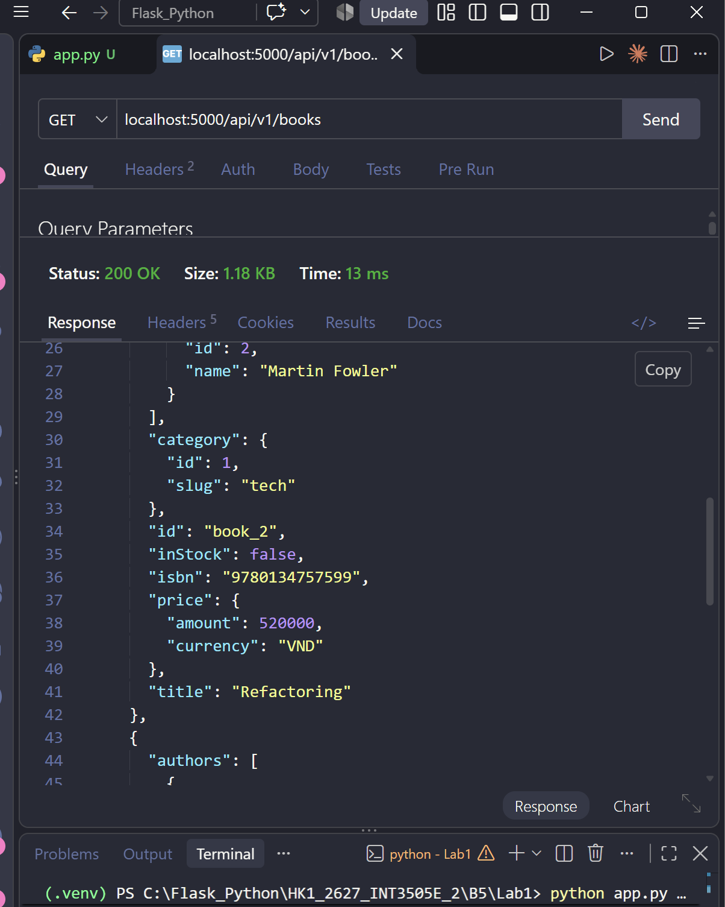
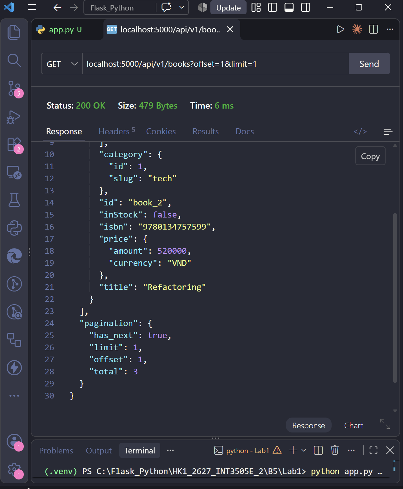
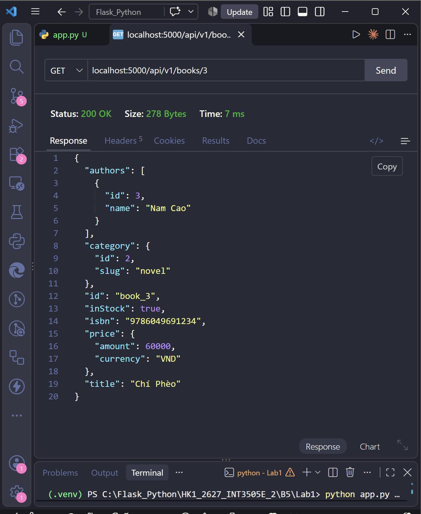
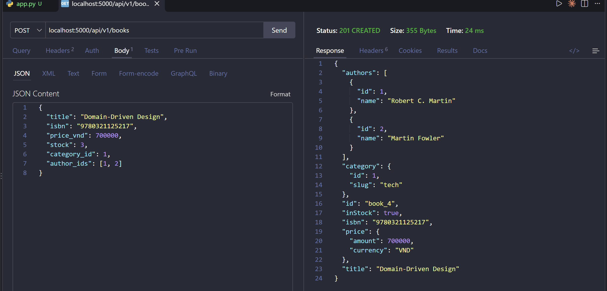
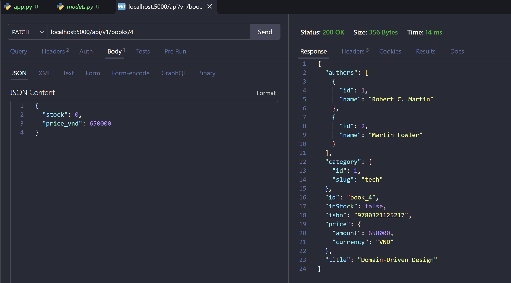
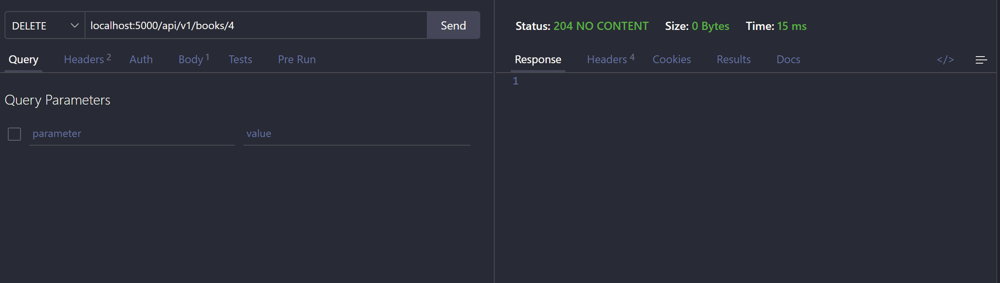
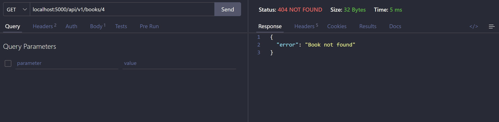
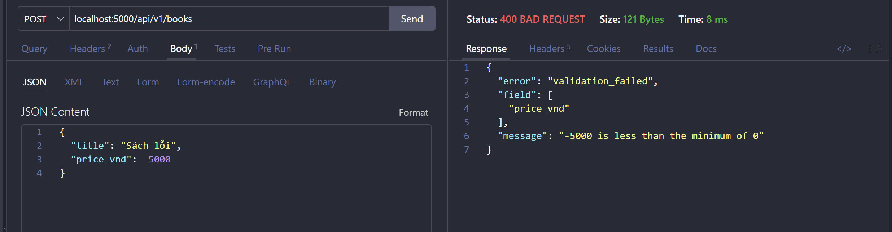
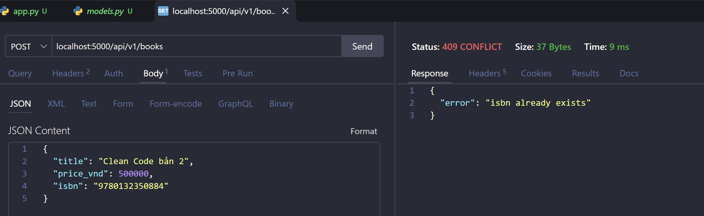

# Lab 1 — Bookstore API (Flask + SQLAlchemy)

## Luồng hoạt động

- `models.py`: khai báo 5 entity `Book`, `Author`, `Category`, `Review`, `User` và bảng nối `BookAuthor` cho quan hệ N:M giữa Book và Author.
- `app.py`: cấu hình SQLite, gắn `db` vào app, đăng ký blueprint, tạo bảng và thêm dữ liệu mẫu khi DB còn trống.
- `routes/books.py`: CRUD tại `/api/v1/books`. Với `POST`/`PATCH`, body được validate theo `schemas/book.json` (JSON Schema), sau đó kiểm tra `category_id`/`author_ids` có tồn tại trong DB rồi mới ghi.
- `to_dict()`: chuyển dòng DB thành JSON trả cho client. Id có tiền tố `book_`, `price` kèm `currency`, `inStock` tính từ `stock`. `category` và `authors` trả về kèm thông tin đầy đủ (tên, slug) ngay trong sách thay vì chỉ trả id, nên client không phải gọi thêm request.

---

## Kết quả thực hành

<table>
  <tr>
    <td align="center">
      
    </td>
    <td align="center">
      
    </td>
  </tr>
  <tr>
    <td width="50%">
      <b>📝 Giải thích ảnh 1:</b> 
      <code>GET /api/v1/books</code> trả về <code>200 OK</code> với 3 sách mẫu. Mỗi sách có id dạng <code>book_2</code>, <code>price</code> kèm <code>currency</code>, thông tin <code>category</code> và <code>authors</code> nằm luôn trong từng sách.
    </td>
    <td width="50%">
      <b>📝 Giải thích ảnh 2:</b> 
      <code>GET /api/v1/books?offset=1&amp;limit=1</code> bỏ qua sách đầu và chỉ trả 1 sách (Refactoring). <code>total: 3</code> là tổng số sách trong DB, <code>has_next: true</code> cho biết còn trang sau.
    </td>
  </tr>

  <tr>
    <td align="center">
      
    </td>
    <td align="center">
      
    </td>
  </tr>
  <tr>
    <td width="50%">
      <b>📝 Giải thích ảnh 3:</b> 
      <code>GET /api/v1/books/3</code> trả về <code>200 OK</code> với sách "Chí Phèo", thuộc category <code>novel</code>, tác giả Nam Cao.
    </td>
    <td width="50%">
      <b>📝 Giải thích ảnh 4:</b> 
      <code>POST /api/v1/books</code> với <code>author_ids: [1, 2]</code> tạo sách <code>book_4</code> và trả về <code>201 Created</code>. Response có 2 tác giả, cho thấy quan hệ N:M qua bảng <code>book_authors</code> đã được lưu.
    </td>
  </tr>

  <tr>
    <td align="center">
      
    </td>
    <td align="center">
      
    </td>
  </tr>
  <tr>
    <td width="50%">
      <b>📝 Giải thích ảnh 5:</b> 
      <code>PATCH /api/v1/books/4</code> chỉ gửi <code>stock</code> và <code>price_vnd</code>. Response <code>200 OK</code>: <code>inStock</code> đổi thành <code>false</code>, giá thành <code>650000</code>, các field khác giữ nguyên.
    </td>
    <td width="50%">
      <b>📝 Giải thích ảnh 6:</b> 
      <code>DELETE /api/v1/books/4</code> xoá sách và trả về <code>204 No Content</code>, không có body.
    </td>
  </tr>

  <tr>
    <td align="center">
      
    </td>
    <td align="center">
      
    </td>
  </tr>
  <tr>
    <td width="50%">
      <b>📝 Giải thích ảnh 7:</b> 
      Gọi lại <code>GET /api/v1/books/4</code> sau khi xoá. Sách không còn nên server trả về <code>404 Not Found</code> với <code>"Book not found"</code>.
    </td>
    <td width="50%">
      <b>📝 Giải thích ảnh 8:</b> 
      <code>POST</code> với <code>price_vnd: -5000</code> vi phạm <code>minimum: 0</code> trong JSON Schema. Server trả về <code>400 Bad Request</code>, chỉ rõ <code>field</code> bị sai và <code>message</code> mô tả lỗi.
    </td>
  </tr>

  <tr>
    <td align="center">
      
    </td>
    <td></td>
  </tr>
  <tr>
    <td width="50%">
      <b>📝 Giải thích ảnh 9:</b> 
      <code>POST</code> với <code>isbn</code> trùng sách Clean Code đã có. Cột <code>isbn</code> là <code>unique</code> nên DB từ chối, server rollback và trả về <code>409 Conflict</code>.
    </td>
    <td></td>
  </tr>
</table>
