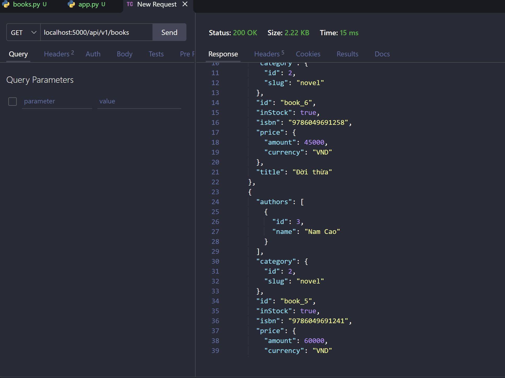
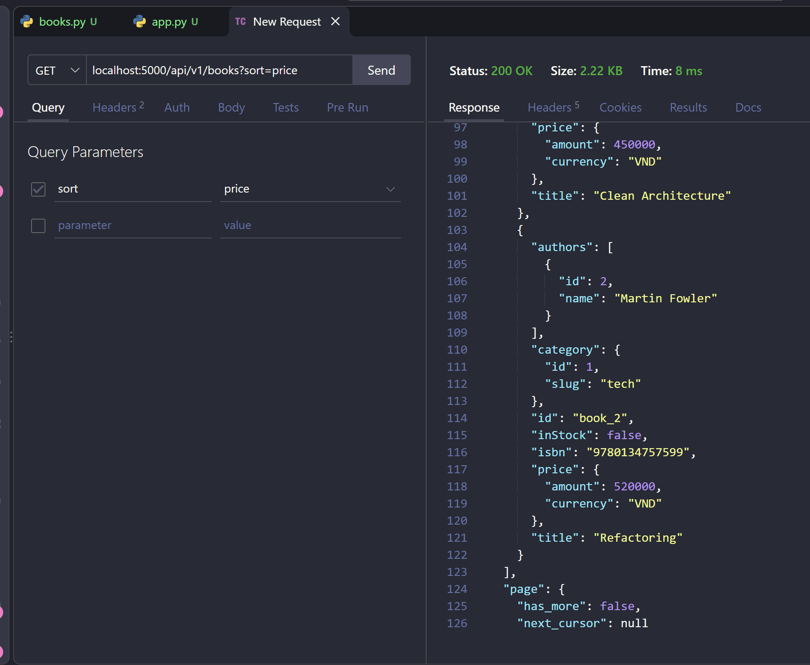
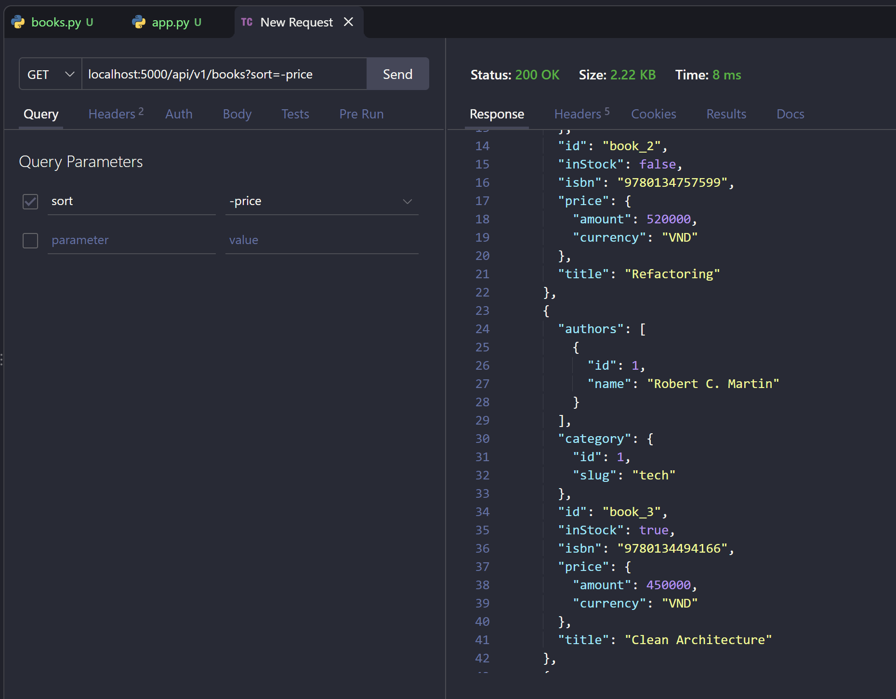
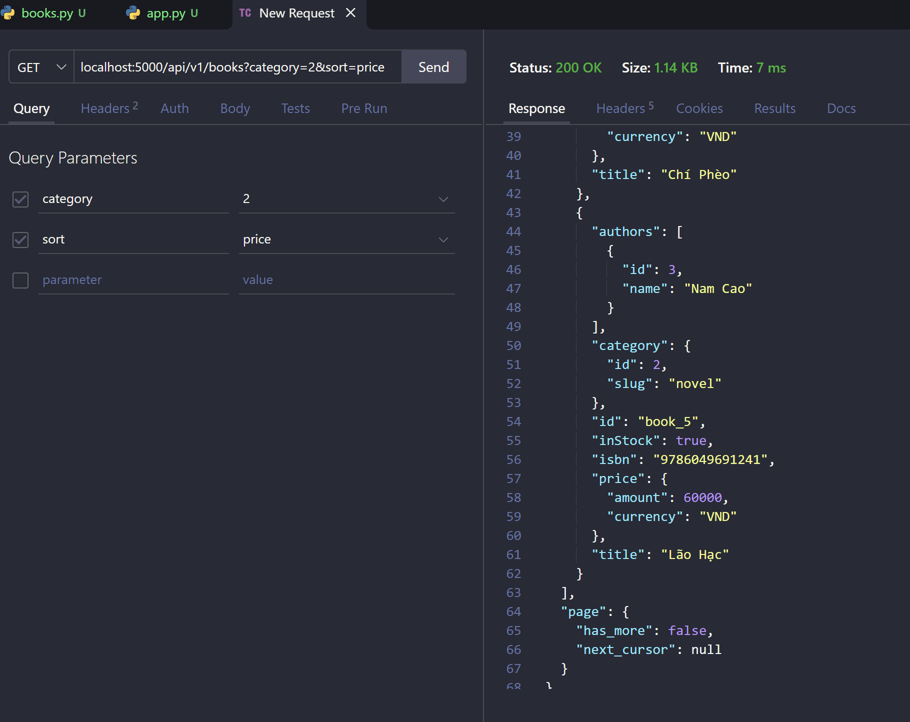
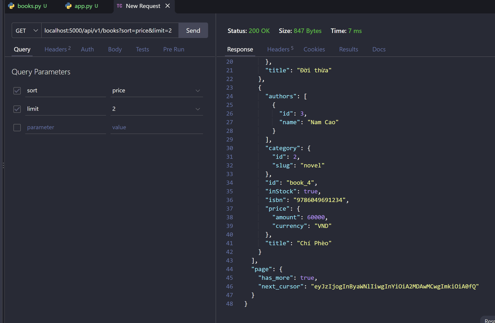
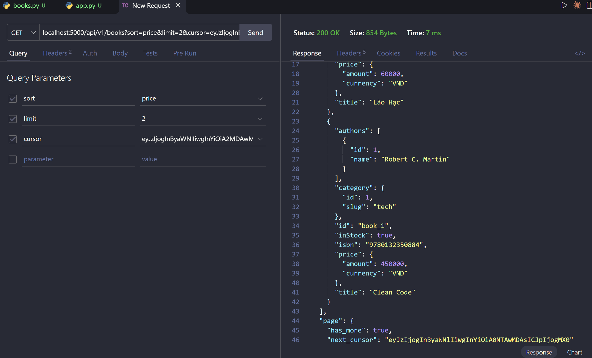
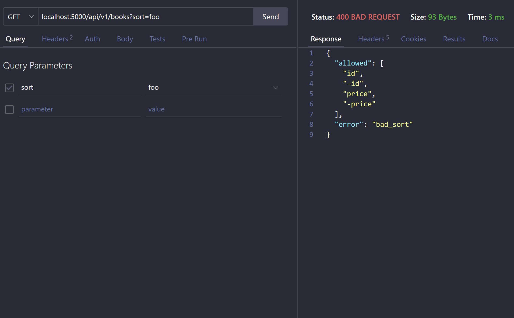
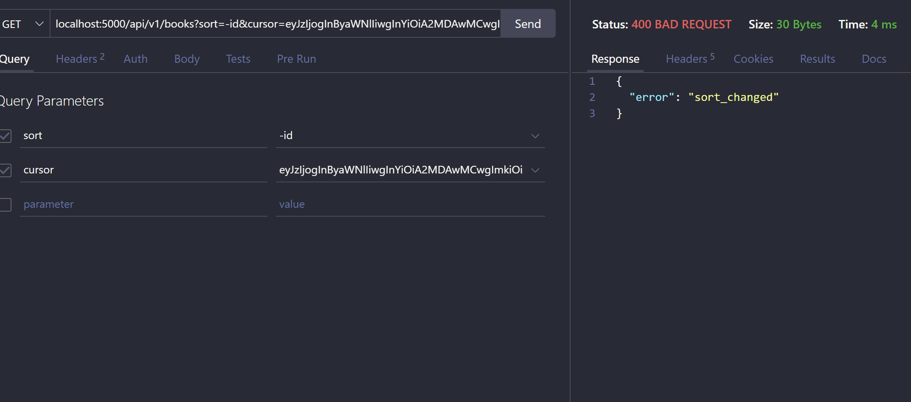
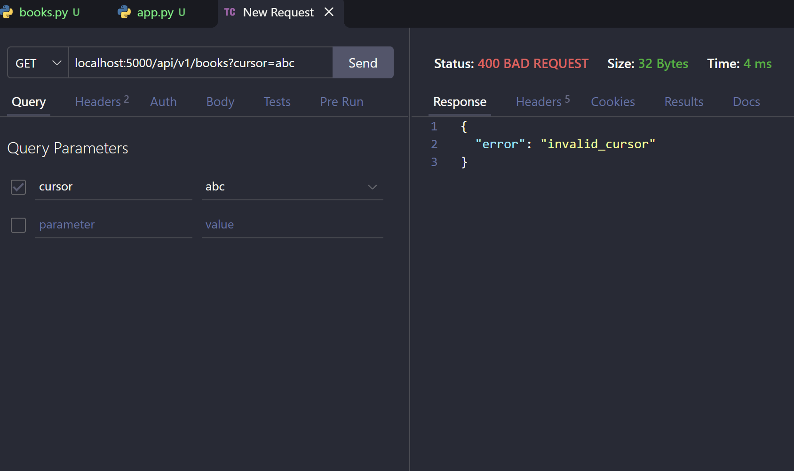

# Lab 2 — Sort, filter và cursor pagination

## Luồng hoạt động

Lab 2 dùng lại code Lab 1 (model, DB, CRUD) và chỉ viết lại route `GET /api/v1/books`:

- `parse_sort`: đọc `?sort=` (`id`, `-id`, `price`, `-price`; dấu `-` là giảm dần). Chỉ nhận key nằm trong whitelist `SORT`, luôn sort thêm theo `id` để sách cùng giá vẫn có thứ tự cố định.
- Lọc: `?category=` chỉ giữ sách thuộc category đó.
- `apply_cursor`: nếu có `?cursor=`, giải mã ra giá trị sort và id của sách cuối trang trước, rồi chỉ lấy các sách đứng sau nó theo cặp `(giá trị sort, id)`. Cursor hỏng hoặc tạo với kiểu sort khác thì trả `400`.
- `build_response`: lấy dư 1 bản ghi để biết còn trang sau. Nếu còn thì tạo `next_cursor` (base64 của `{"s": sort, "v": giá trị sort, "i": id}`) cho client gửi lại ở request tiếp theo.
- `app.py` thêm 3 sách mẫu, trong đó có sách trùng giá để kiểm tra thứ tự khi bằng giá.

---

## Kết quả thực hành

<table>
  <tr>
    <td align="center">
      
    </td>
    <td align="center">
      
    </td>
  </tr>
  <tr>
    <td width="50%">
      <b>📝 Giải thích ảnh 1:</b> 
      <code>GET /api/v1/books</code> không truyền <code>sort</code> nên dùng mặc định <code>-id</code>: sách mới nhất đứng đầu (<code>book_6</code>, <code>book_5</code>, ...).
    </td>
    <td width="50%">
      <b>📝 Giải thích ảnh 2:</b> 
      <code>?sort=price</code> sắp xếp giá tăng dần, sách đắt nhất Refactoring (520000) nằm cuối. Trả hết trong 1 trang nên <code>has_more: false</code>, <code>next_cursor: null</code>.
    </td>
  </tr>

  <tr>
    <td align="center">
      
    </td>
    <td align="center">
      
    </td>
  </tr>
  <tr>
    <td width="50%">
      <b>📝 Giải thích ảnh 3:</b> 
      <code>?sort=-price</code> sắp xếp giá giảm dần: Refactoring (520000) đứng đầu, tiếp theo là sách giá 450000.
    </td>
    <td width="50%">
      <b>📝 Giải thích ảnh 4:</b> 
      <code>?category=2&amp;sort=price</code> chỉ trả các sách thuộc category <code>novel</code> (Nam Cao), sắp theo giá tăng dần. Chí Phèo và Lão Hạc cùng giá 60000 nên xếp theo id.
    </td>
  </tr>

  <tr>
    <td align="center">
      
    </td>
    <td align="center">
      
    </td>
  </tr>
  <tr>
    <td width="50%">
      <b>📝 Giải thích ảnh 5:</b> 
      <code>?sort=price&amp;limit=2</code> trả trang 1 gồm Đời thừa và Chí Phèo (<code>book_4</code>, 60000). Còn dữ liệu nên <code>has_more: true</code> và có <code>next_cursor</code>.
    </td>
    <td width="50%">
      <b>📝 Giải thích ảnh 6:</b> 
      Gửi lại <code>next_cursor</code> của ảnh 5 để lấy trang 2: Lão Hạc và Clean Code. Lão Hạc cùng giá 60000 với Chí Phèo ở trang 1 nhưng không bị mất hay lặp, nhờ cursor lưu cả giá và id.
    </td>
  </tr>

  <tr>
    <td align="center">
      
    </td>
    <td align="center">
      
    </td>
  </tr>
  <tr>
    <td width="50%">
      <b>📝 Giải thích ảnh 7:</b> 
      <code>?sort=foo</code> không có trong whitelist nên server trả <code>400 Bad Request</code> với <code>bad_sort</code> và danh sách giá trị được phép.
    </td>
    <td width="50%">
      <b>📝 Giải thích ảnh 8:</b> 
      Dùng cursor tạo khi <code>sort=price</code> cho request <code>sort=-id</code>. Vị trí trong cursor không còn đúng với cách sắp xếp mới nên server trả <code>400</code> với <code>sort_changed</code>.
    </td>
  </tr>

  <tr>
    <td align="center">
      
    </td>
    <td></td>
  </tr>
  <tr>
    <td width="50%">
      <b>📝 Giải thích ảnh 9:</b> 
      <code>?cursor=abc</code> không giải mã được thành cursor hợp lệ nên server trả <code>400</code> với <code>invalid_cursor</code> thay vì lỗi 500.
    </td>
    <td></td>
  </tr>
</table>
